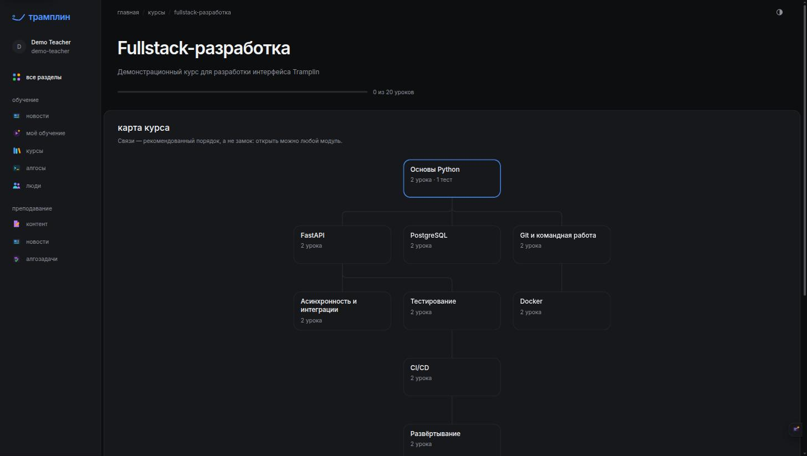
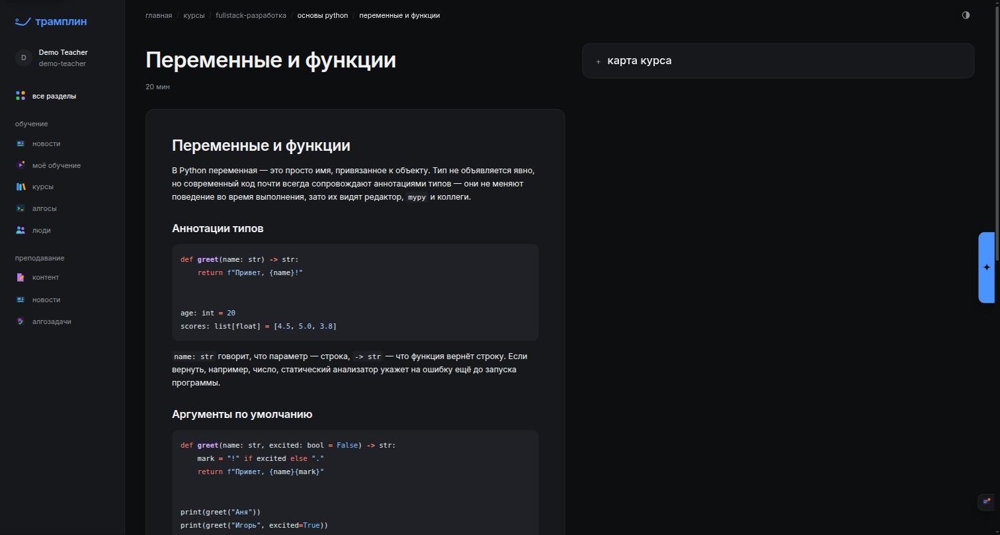
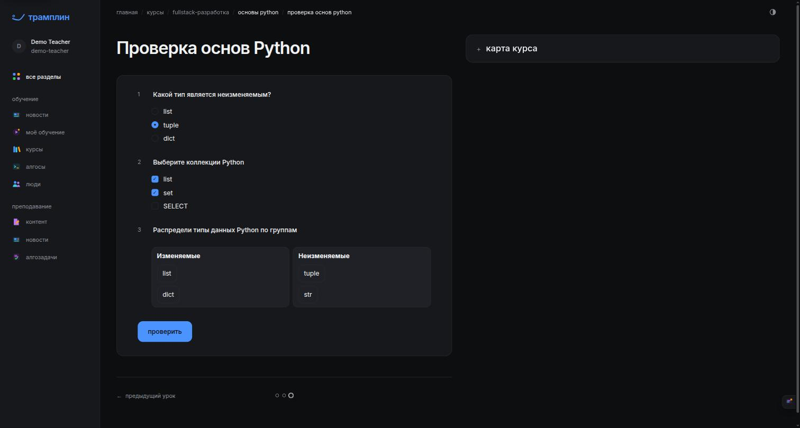
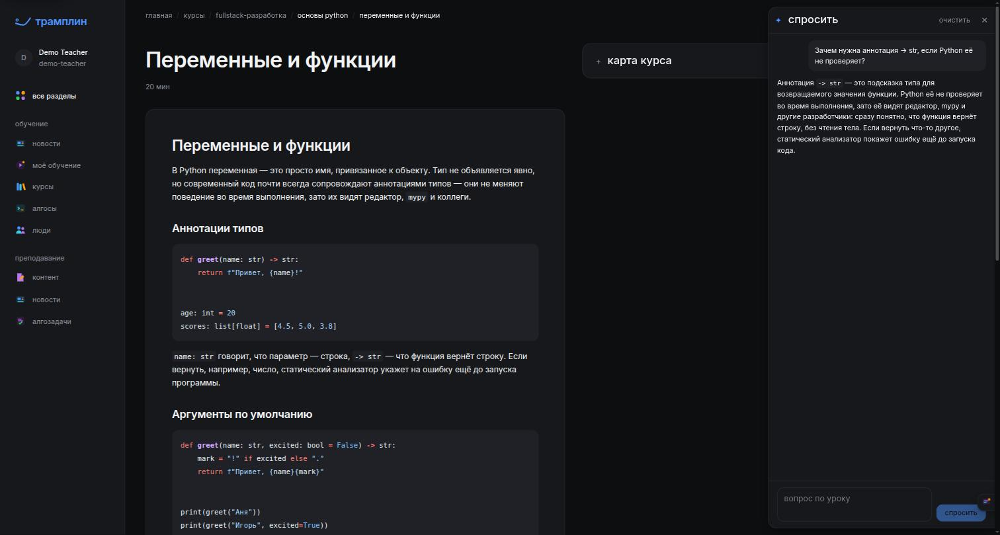
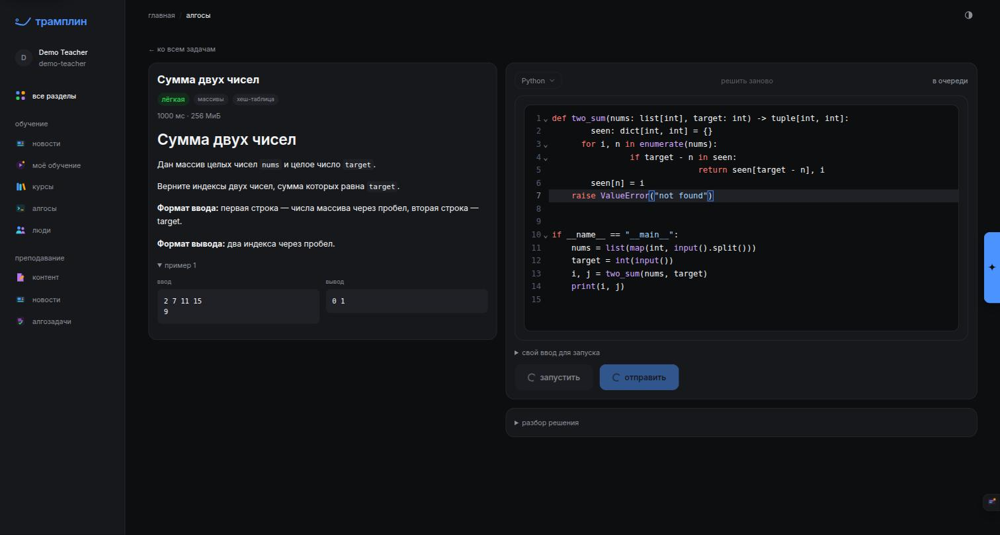
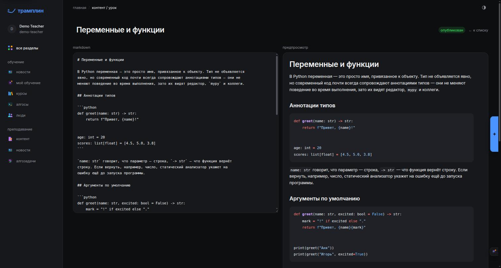
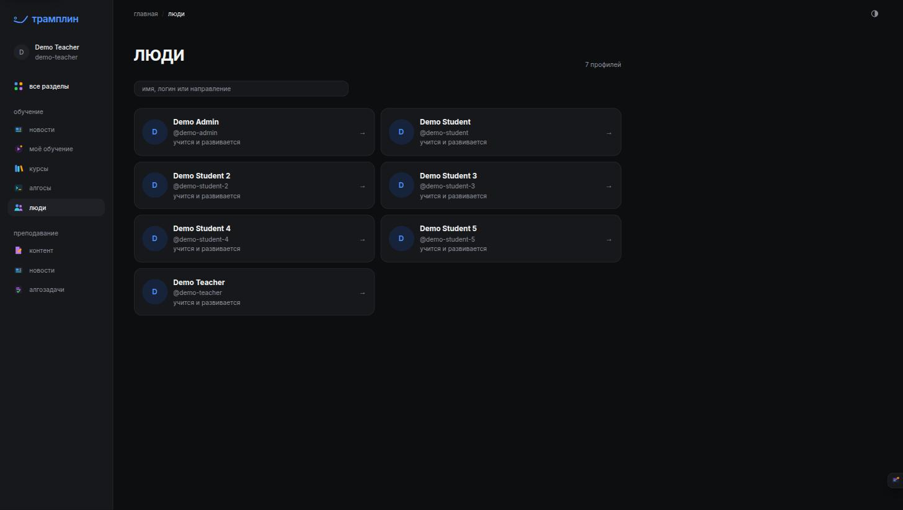
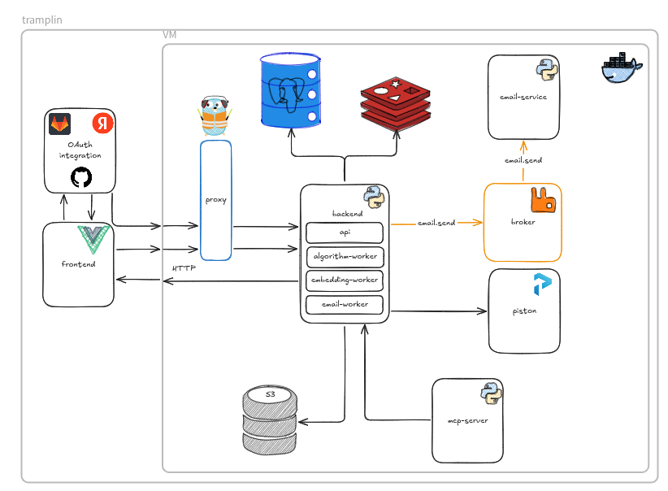

# Трамплин

### Знания становятся практикой

Учебная платформа: курсы с картой модулей, интерактивные тесты,
алгоритмические задачи с запуском кода и AI-тьютор рядом с материалом.

---

## Зачем

Учебный процесс в колледже разбросан по файлам, чатам и разным сервисам: теория в одном месте,
практика в другом, а помощь — только на паре. **Трамплин** собирает путь от первого урока
до работающего кода в одно пространство — с прогрессом, практикой и AI-помощью по ходу.
Преподаватели создают и публикуют материалы там же. Бизнес-ценность и пользовательские
кейсы — в [спецификациях](https://gitlab.com/tramplin1/specs).

## Как это работает

| 🗺️ Учиться | 🧩 Проверять себя | 💻 Практиковаться | ✍️ Преподавать |
| :---: | :---: | :---: | :---: |
| Карта курса связывает модули и уроки в маршрут, прогресс возвращает туда, где остановился | Тесты с разными типами ответов и интерактивными заданиями, AI-тьютор по материалу урока | Условие, редактор и запуск кода на одном экране; решения выполняются в изолированном Piston | Редактор уроков с live-превью, публикация и AI-агенты, наполняющие курс через MCP |

 
Карта курса «Fullstack-разработка»: модули, связи и прогресс студента

📸 Ещё скриншоты: урок, тест, AI-тьютор, задачи, редактор, люди

<table>
<tr>
<td width="50%"> Урок с Markdown и подсветкой кода</td>
<td width="50%"> Интерактивный тест с перетаскиванием</td>
</tr>
<tr>
<td> AI-тьютор по материалам урока</td>
<td> Алгоритмическая задача: код, запуск, отправка</td>
</tr>
<tr>
<td> Редактор урока с предпросмотром</td>
<td> Профили пользователей платформы</td>
</tr>
</table>

## В цифрах

Покрытие тестами backend и email-service — не ниже 90 %; integration-тесты проверяют каждый
эндпоинт на настоящем PostgreSQL. Интерфейс — на русском и английском.

## Под капотом

<table>
<tr><th colspan="2">🎓 Продукт</th></tr>
<tr>
<td width="48" align="center">🖥️</td>
<td><a href="https://gitlab.com/tramplin1/frontend"><b>frontend</b></a> — интерфейс студента, преподавателя и администратора: каталог, уроки, тесты, практика алгоритмов Vue 3 · TypeScript · Vite · Pinia · TanStack Query · CodeMirror</td>
</tr>
<tr>
<td align="center">⚙️</td>
<td><a href="https://gitlab.com/tramplin1/backend"><b>backend</b></a> — API, авторизация, курсы, прогресс, рекомендации, AI-тьютор и ассистент; единственный владелец базы Python 3.14 · FastAPI · SQLAlchemy · Dishka · FastStream · pgvector</td>
</tr>
<tr>
<td align="center">📨</td>
<td><a href="https://gitlab.com/tramplin1/email-service"><b>email-service</b></a> — доставка писем из очереди в SMTP с circuit breaker Python · FastStream · RabbitMQ · aiosmtplib</td>
</tr>
<tr><th colspan="2">🤖 AI-агенты</th></tr>
<tr>
<td align="center">🔌</td>
<td><a href="https://gitlab.com/tramplin1/mcp-server"><b>mcp-server</b></a> — Codex, Claude Code и другие агенты наполняют курсы от имени преподавателя: план, валидация, diff, применение FastMCP · httpx · OAuth 2.1 + PKCE</td>
</tr>
<tr><th colspan="2">🏗️ Платформа</th></tr>
<tr>
<td align="center">🏗️</td>
<td><a href="https://gitlab.com/tramplin1/infra"><b>infra</b></a> — stage/prod: HTTPS-прокси, брокер, изолированный запуск кода, логи и метрики Docker Compose · Caddy · RabbitMQ · Piston · Prometheus / Loki / Grafana / Alloy</td>
</tr>
<tr><th colspan="2">📚 Знания</th></tr>
<tr>
<td align="center">📚</td>
<td><a href="https://gitlab.com/tramplin1/specs"><b>specs</b></a> — бизнес-ценность, продукты, пользовательские кейсы по ролям и спецификации изменений Markdown</td>
</tr>
</table>

 
Backend — единственный владелец базы данных. Email-service берёт задания из RabbitMQ, MCP-сервер ходит в API backend, Piston живёт во внутренней сети без доступа к базе

## Команда

<table>
<tr>
<td align="center">
<a href="https://gitlab.com/semao0"> <b>Семён Белоусов</b></a> 
Backend · Frontend · Инфраструктура
</td>
</tr>
</table>

Трамплин · 2026

