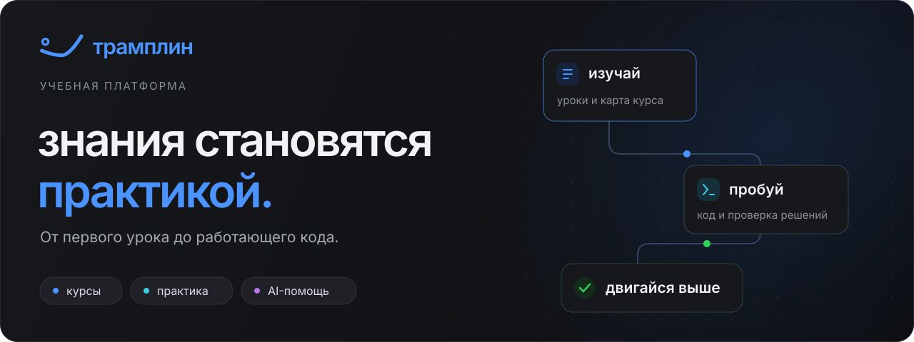

<p align="center">
  <a href="#обучение">Обучение</a> ·
  <a href="#практика">Практика</a> ·
  <a href="#преподавание">Преподавание</a> ·
  <a href="#под-капотом">Под капотом</a> ·
  <a href="#локальный-запуск">Запустить локально</a>
</p>

**Трамплин** объединяет путь от первого урока до работающего кода: курсы с картой модулей, интерактивные тесты, алгоритмические задачи и AI-тьютор рядом. Преподаватели создают и публикуют материалы в том же пространстве.

Учебная платформа колледжа ННГУ · Курсовой проект

## Обучение

### Весь маршрут перед глазами

Карта курса связывает модули и уроки в понятный маршрут. Связи подсказывают порядок изучения, а прогресс помогает вернуться к тому, на чём остановился.

[](assets/screenshots/course-map.jpg)

**Читать и пробовать.** Уроки с Markdown и подсветкой кода, тесты с разными типами ответов и интерактивными заданиями.

**Спрашивать по ходу.** AI-тьютор помогает разобраться в материале урока. Рекомендации учитывают интересы и прогресс студента.

<details>
<summary>Посмотреть урок, интерактивный тест и AI-тьютора</summary>

### Урок


### Интерактивный тест


### AI-тьютор


</details>

## Практика

### От условия — к работающему решению

Условие задачи, редактор кода и запуск решения на одном экране. Несколько языков программирования, свой ввод для проверки и тест-кейсы для оценки результата.

[](assets/screenshots/algorithm-solve.jpg)

Код выполняется в изолированном окружении **Piston**, задания проходят через очередь **RabbitMQ**.

## Преподавание

### Создавать курсы так же удобно, как проходить

Редактор уроков с предпросмотром Markdown, управление модулями и тестами, публикация материалов и AI-ассистент для авторов. Администраторы управляют пользователями и новостями платформы.

<details>
<summary>Посмотреть редактор урока и профили пользователей</summary>

### Редактор урока


### Люди


</details>

**Курс можно наполнить и через AI-агента.** MCP-сервер подключает Codex, Claude Code и другие совместимые инструменты: вход под преподавателем через OAuth, чтение материалов, валидация изменений, просмотр diff и применение плана через API.

## Под капотом

Пять самостоятельных сервисов со своими репозиториями, документацией и CI/CD.

| Репозиторий | За что отвечает | Основной стек |
| :--- | :--- | :--- |
| [**frontend ↗**](https://gitlab.com/tramplin1/frontend) | Интерфейс студента, преподавателя и администратора | Vue 3 · TypeScript · Vite · Pinia |
| [**backend ↗**](https://gitlab.com/tramplin1/backend) | API, авторизация, курсы, прогресс и рекомендации | FastAPI · PostgreSQL · pgvector · Redis |
| [**email-service ↗**](https://gitlab.com/tramplin1/email-service) | Доставка писем из очереди в SMTP | FastStream · RabbitMQ · aiosmtplib |
| [**mcp-server ↗**](https://gitlab.com/tramplin1/mcp-server) | Работа AI-агентов с учебными материалами | FastMCP · httpx · OAuth 2.1 + PKCE |
| [**infra ↗**](https://gitlab.com/tramplin1/infra) | Развёртывание, выполнение кода и наблюдаемость | Docker Compose · Caddy · Piston · Grafana |

<details>
<summary>Архитектура и границы сервисов</summary>


**Backend — единственный владелец базы данных.** Email-service получает задания из RabbitMQ и отправляет готовые письма; MCP-сервер обращается к API backend. Piston доступен только во внутренней сети и не имеет доступа к базе.

Вход в платформу — по email-коду или через GitHub и Яндекс; сессии используют JWT. Доставка писем защищена circuit breaker.

</details>

<details>
<summary>Инструменты разработки и качество</summary>

- **Backend:** Python 3.14, асинхронный SQLAlchemy, Alembic, Dishka, FastStream и uv.
- **Frontend:** Vue Router, Reka UI, CodeMirror и Vitest.
- **Наблюдаемость:** Prometheus, Loki, Grafana и Alloy.
- **Проверки:** Ruff, mypy в строгом режиме, pytest с покрытием ≥90% для backend и email-service; ESLint, Prettier и Vitest для frontend.
- **CI/CD:** GitLab-пайплайны с линтингом, тестами, security-сканированием и деплоем immutable-образов на stage/prod.

</details>

## Локальный запуск

Начните с [инструкции backend](https://gitlab.com/tramplin1/backend) и [инструкции frontend](https://gitlab.com/tramplin1/frontend): в них описаны зависимости и переменные окружения.

В каталоге **backend**:

```sh
make up && make migrate && make seed && make run
```

В отдельном терминале, в каталоге **frontend**:

```sh
pnpm install --frozen-lockfile && pnpm dev
```

Интерфейс откроется на **http://localhost:5173**. Для выполнения алгоритмических задач и полной инфраструктуры подключите [infra](https://gitlab.com/tramplin1/infra), для доставки писем — [email-service](https://gitlab.com/tramplin1/email-service), для внешних AI-агентов — [mcp-server](https://gitlab.com/tramplin1/mcp-server). AI-функции требуют настройки LLM-провайдера в backend.

---

[PRD алгоритмической практики](https://gitlab.com/tramplin1/backend/-/blob/main/artifacts/prd/algorithmic-sessions.md) · [PRD авторинга задач через MCP](https://gitlab.com/tramplin1/mcp-server/-/blob/main/docs/algorithm-authoring-prd.md)
